# Behaviour

What the user sees and can do, the same in both hosts. Widgets differ
(Super Productivity's look in the plugin, libadwaita in Pensum); screens,
flows, texts and order do not. Rules behind it: [design rules](psychology.md),
[game rules](game-rules.md), [data model](data-model.md). The look of
the journey is in [journey design](journey-design.md).

## Principles for every screen

- Works at 360 × 720 and on the desktop; no horizontal scrolling; touch
  targets at least 44 × 44 px.
- The main action of a screen is at the bottom (thumb reach); title,
  back and menu at the top.
- States are shown with text and shape, never by colour alone.
- No text field is focused when a screen opens.
- **The plan sentence** is one whole sentence per form in
  `content/i18n` (`ui.plan.sentence`, `-place`, `-pair`, `-place-pair`),
  filled with the stage's anchor, action and place and, for a stage of a
  run, what the user pairs it with (design rule 7): "After lunch, I will
  walk for 15 minutes (in the park), with my podcast." A language orders
  the parts as it needs; no sentence is glued together from pieces. The
  pairing is the user's text as stored, one line without a final full
  stop, and is not translated.
- **The user's anchor stands in the plan** (#96, design rule 2). For a
  run that has one, the sentence starts with the user's words instead
  of the journey's suggestion: a routine ("After my first coffee, I
  will …", `ui.plan.sentence…`), a fixed time ("At 21:30, I will …",
  `ui.plan.at…`) or, in a chain, the step it follows ("After I drink a
  glass of water, I will …", `ui.plan.then…`); each again in the four
  forms with place and pairing. The question of the weekly look back
  names the habit the same way ("… after my first coffee", "… at
  21:30"). A moment is named as "After getting up" or "At 21:30"
  (`ui.anchor.after`, `ui.anchor.at`), or by the name the user gave it.
  To the user an anchor is a **moment**; German says "Moment" ("Ein
  neuer Moment", "Diesen Moment erweitern"), and the routine completes
  "Nach …" as it completes "After …" here, so a German user writes the
  dative ("dem Mittagessen").
- **Language** (#39). The hosts show English or German: the plugin
  follows Super Productivity's language (read at start with
  `getCurrentLanguage`, then on every `languageChange`), the standalone
  app the device's language or `?lang=`, Pensum its locale (through the
  engine's command line, `texts`). Any other language, and any key a
  language lacks, shows English. A change of language redraws the open
  screen in place. German texts say "du", never "Sie"; they are written,
  not translated word for word, and follow the same rules as English:
  "du könntest", "wenn du magst", never "du musst", "du solltest" or
  "nicht vergessen"; a miss is "eine Lücke" or "ein Tag Pause"; the
  fallback is "der kleinere Schritt". German buttons and titles follow
  German spelling ("Noch eine Weile bleiben"), not English header
  capitalisation. The German plan sentence puts the verb second ("Nach
  dem Mittagessen gehe ich 15 Minuten spazieren, mit meinem Podcast."),
  so each German action has its plan form ([story
  format](story-format.md), texts); a fixed time reads "Um 21:30 Uhr …",
  a chain "Nach „ein Glas Wasser trinken“ …". The pairing is the user's
  text as stored, so the German hint asks for the dative ("meinem
  Podcast").
- There is one look and no mode: no XP, no levels, no guardians and no
  game words (#110). Every journey shows what it builds.
- Texts are autonomy-supportive ("you could"), never controlling or
  blaming, and never promise a number of days.

## Screens

### 0. Home: the Valley

Issues #96 and #129 ([#114](https://github.com/nexumia-de/quest-arc/issues/114)
decisions 1, 2, 6, 7 and 9), [design rule 28](psychology.md): the home of
QuestArc is the user's moments, not a list of habits, drawn as the
**Valley**: one path through the day, a place for every moment. It is
drawn from the engine's `valley` view ([game rules](game-rules.md) §8) and
the layout `valleyLayout` ([journey design](journey-design.md), "The place
piece"); the screen places nothing by hand.

| 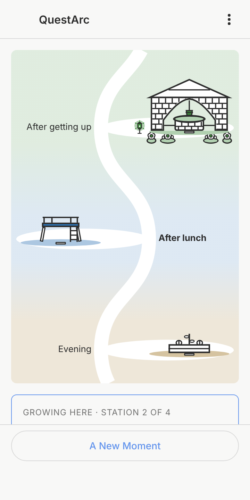 | 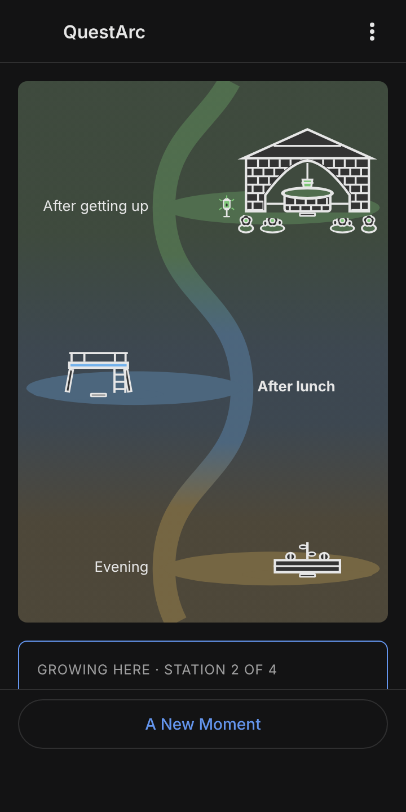 |
| ---------------------------------------------------------- | -------------------------------------------------------- |

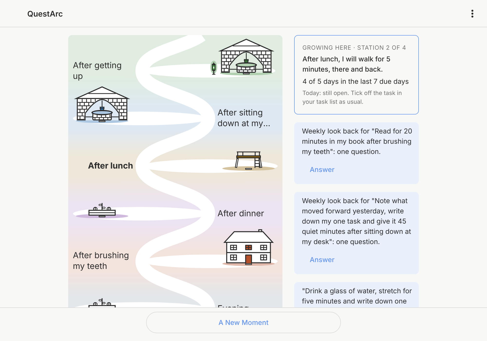

With [one](screenshots/valley-home-1-phone-light.png) and
[six](screenshots/valley-home-6-phone-light.png) places, and
[dark](screenshots/valley-home-6-desktop-dark.png) on the desktop.
_Screenshots from demo data at 360 × 720 and 1000 × 700._ A place draws
every thing that stands there (up to three, game rules §8): the second
and third side by side behind the first, each on its own ground patch
(#151, [journey
design](journey-design.md#the-place-piece-the-valley-127)); demo
`valley-6-stacked`, [phone](screenshots/valley-home-stacked-phone.png) and
[desktop](screenshots/valley-home-stacked-desktop.png), light and dark.

- **The scene** is the page's picture. Per place, from the layout: the
  ground in the place's hue, blending into the next place's; the path and
  the bays in the host's background; the place's **thing** in its current
  version, in the place's hue; and the place's **name** on the free side
  (the name the user gave the moment, else "After getting up" or "At
  21:30"). The growing place's name is **bold**: the shape, not the colour,
  tells which one grows. A free place does not exist: a place is a moment,
  and where no journey stands yet the place is plain land with its name.
  Nothing marks a place as free, nothing is announced, nothing is counted.
- **The scene is built in layers**, back to front: ground, path and bay,
  thing, marker, lantern, name.
- **The sign** (#131), in the Valley and on the place: the lit lantern,
  about as high as the thing's door, apart from the thing beside the
  doorstep towards the path, when the routine there runs by itself. It
  is the place's only sign; it appears when earned, never before, and
  nothing on the screen names what is still to come. For screen readers
  the place's words say it: "The lantern is lit: the routine runs by
  itself." (pictures and layers in
  [journey design](journey-design.md#the-sign-of-a-place-the-valley-131)).
- **Tapping a place** opens it: the journey (screen 4) for the growing
  place; for any other the place (screen 0b), also where nothing stands
  yet. "Change this moment" (screen 0a) is reached from the place by its
  pencil. Each place is one button of at least 44 × 44 px,
  its row from edge to edge. A place never opens by itself; back leads to
  the Valley.
- **For screen readers** the scene is a section "The Valley: your moments
  along the path of the day" whose buttons say each place in words, in
  the order of the day: "After lunch: A lookout platform, version 2 of 5.
  Growing here. The lantern is lit: the routine runs by itself." (name,
  thing and version, the growing step, the sign). The drawing itself is
  hidden from them.
- **Size.** The scene is 360 units wide and about **two thirds of the
  window high** (480 units in a 720-high window, never less: the
  layout's checks hold from 480 for any number of places), so the growing
  card starts on the first screen; `valleyLayout` takes the height, the
  screen draws nothing of its own. With more than six places the scene is
  longer and scrolls with the page. It is as wide as the page up to 440
  px, so there is no horizontal scrolling at 360 or narrower; the names'
  text size follows its width. At 720 px and wider the scene stands on the
  left and the card on the right.
- **Path and bays** are one colour, so a bay reads as the path widening:
  the host's background in the light theme; in the dark theme the place's
  `tint-strong` (the hue's 40 %, along the path as the places' hues follow
  each other), lighter than the ground's 16 % tint, so the path is not a
  hole in it.
- **Below the scene, within thumb reach:**
  - **The growing step** (at most one, on the moment the active journey
    starts from) is a card that opens the journey (screen 4): "Growing
    here · Station 2 of 4", the plan sentence, the condition in words ("4
    of 5 days in the last 7 due days") and one line of state: "Today:
    done." or "Today: still open. Tick off the task in your task list as
    usual." on a due day, "You reached this station. You can continue
    whenever you like.", "This station needs a recurring task.", "Paused.
    Paused days don't count.", or "Good to see you." when the card after a
    long break waits on the journey (flow D). In Super Productivity the
    tick itself stays in the task list (flow A). Nothing else stands
    under it: the home has no button for changing the moment (the pencil
    on the place, screens 4 and 0b).
  - **Banners**, as before: the undo after ending a journey, and for the
    habits finished journeys left (flow F) at most one each: the question
    after graduation, the offer to graduate, or the weekly look back.
  - **A journey from before anchors** asks once, in a card: "QuestArc now
    starts from moments in your day. Your journey began with this one. Is
    it still yours?" with **Yes, That Is It** (`confirmAnchor` with the
    suggested words) and **Change the Words** (screen 0a, which confirms
    with what the user writes). Nothing depends on the answer and nothing
    is asked again: until then everything works with the journey's words,
    and the moment has no place in the Valley.
  - The main action at the bottom: **A New Moment** (screen 2; an
    outlined button while a journey is active).
- **What the list said in words** ("Runs by itself", "Still followed",
  "Waiting") is no longer on the home: the place's sign says it in the
  scene's words, and the place's own page (screen 0b) lists the steps. Nothing is ticked, counted or shown as due for what runs by
  itself.
- **Nothing animates on opening.** When a new version of a thing appears
  while the screen is open, it grows in with the calm animation of the
  journey screen (scale from 0.6 and fade, 600 ms); under
  `prefers-reduced-motion: reduce` nothing moves.
- **No moment yet:** plain land with the path (a short scene, so the words
  stay in view), "No moment yet" and "QuestArc starts from a moment that
  already exists in your day, like getting up or lunch. A journey adds one
  small step to it. You keep using your normal tasks.", and **A New Moment**
  as the main action. Nothing marks a free place.
- The menu has Shelf and Settings. When the active journey is read-only,
  its calm page stands here instead (screen 4).

### 0a. A moment

- **When it is**: two options, **After …** with a text field for the
  routine in the user's words (at most 40 characters, not focused;
  "What you already do right before. Only you see this.") and **At a
  fixed time** with a time field. A fixed time differs from a routine
  only in words: its title and plan say "At 21:30" instead of "After
  …", the time is written as the host's language writes times (24
  hours here), and where QuestArc suggests a reminder for the task
  (flow B) it names that time. Nothing else is different: no clock
  icon, no other colour, and nothing is counted by the clock.
- **A name for this moment** (optional, "like "Morning"").
- "Your tasks keep the titles you gave them; QuestArc changes none."
- Main action: **Save** (`nameAnchor`; for a journey from before
  anchors `confirmAnchor`). Without words or a time: "A moment needs a
  few words or a time." A leading "after" the user typed is not
  doubled.
- **Where in your day** (#130, [#114](https://github.com/nexumia-de/quest-arc/issues/114)
  decisions 3 and 10), for a moment that has a place: the places in the
  order of the day as a numbered list in words, this one in bold with
  "This moment" after it, then **Move Earlier** and **Move Later**
  (disabled at the ends). **Side of the path**: **Left** or **Right**,
  the side the thing stands on. **Colour**: the eight hues, each a swatch
  with its name (the name carries it, not the colour). Where a thing
  stands there are two more choices, **What grows** (the kind of every
  thing at the place, changeable after it has grown) and, once a second
  marker kind exists, **What hangs** (screen 3a, #158). Each change is
  written at once, as the engine's `movePlace`, `choosePlaceSide`,
  `choosePlaceHue`, `choosePlaceKind` or `choosePlaceMarker` makes it
  (`place:<anchorId>` records); the screen
  keeps what was typed above. **Use the suggestion** (only while
  something was chosen) withdraws all (`withdrawPlace`): the place
  goes back to its position by the kind of moment, the alternating side,
  the hue by position, the ladder the first journey's file names and flowers. The hue belongs to the place, not to the
  journey ([game rules](game-rules.md) §8).
- **Extend This Moment** while no journey grows at the moment: screen 2
  for it (also on the place, screen 0b).

| 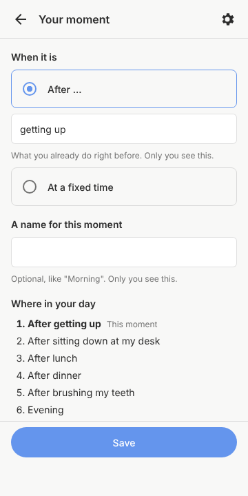 | 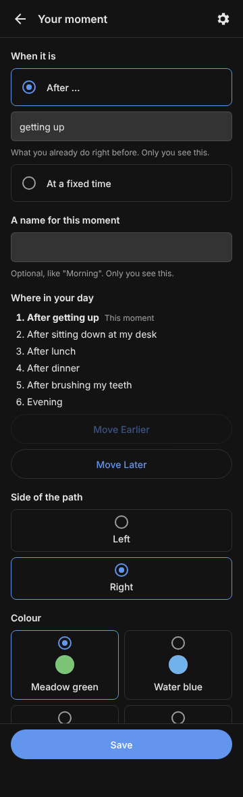 |
| --------------------------------------------------------- | ------------------------------------------------------- |

- **Remove This Moment** only while nothing stands there ("Nothing
  stands here yet, so nothing is lost.", `removeAnchor`).

### 0b. The place

#130 ([#114](https://github.com/nexumia-de/quest-arc/issues/114) decisions
4, 5 and 12): a place without a growing journey opens here, from the
Valley, also where nothing stands yet. The growing place opens its
journey (screen 4), which draws the same piece.

| 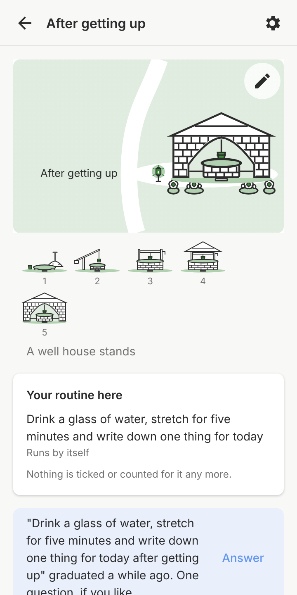 | 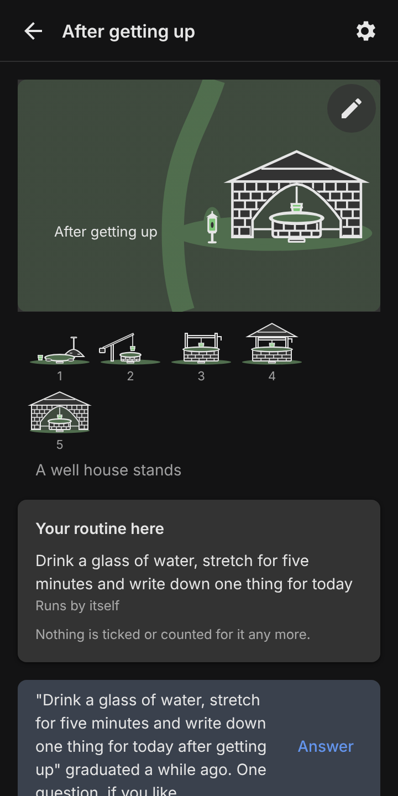 |
| ------------------------------------------------------- | ----------------------------------------------------- |

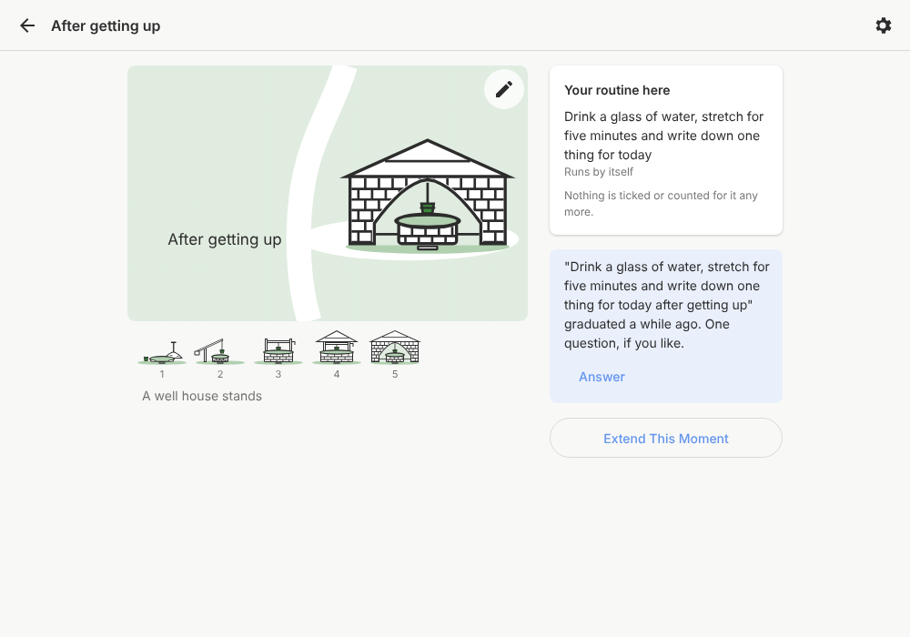

_Screenshots from demo data: the place's routine runs by itself, so its
lantern is lit beside the doorstep (#131)._

- Title: the place's name (the moment's name, else "After getting up").
  Back leads to the Valley.
- **The place piece**, large (the Valley's layout for one place,
  [journey design](journey-design.md#the-place-piece-the-valley-127), 230
  units high): the ground in the place's hue, the path and the bay, every
  thing at the place in the version that stands and its hue (the second
  and third side by side behind the first on their own ground patches,
  #151), the name; the place's sign (the lit
  lantern) in the layers of the Valley's scene (#131). The **pencil** at
  its top corner on the free side of the path (44 × 44), clear of the
  things behind, opens "Change this moment" (screen 0a). Where nothing stands yet the piece is plain land with the
  name.
- **The versions that stand**, as on the journey screen (the row of
  small pictures with their numbers; a version that stands for a skipped
  stage says "already yours"), and the line of state ("A well house
  stands"), once per thing: where the place holds more than one (up to
  three, game rules §8) each row is headed by the title of the journey
  that grows it. The piece draws every thing, the second and third
  behind the first (#151). Journeys beyond three build no thing and
  have no row.
- **One card, "Your routine here"**: the routine's steps in words, each
  with **Still followed** or **Runs by itself**, and what waits with
  **Waiting**; for a step that runs by itself also "Nothing is ticked or
  counted for it any more." Nothing is ticked, counted or shown as due
  for it. Where no step stands: "Nothing stands here yet."
- **The questions that are due** at this moment, as banners (flow F):
  the weekly question, the question after graduation, the offer to
  graduate. Banners of other places stay on the home.
- **Extend This Moment** (screen 2 for this moment).
- Screen readers get the piece as the place in words ("After lunch: …,
  version 2 of 5. …"); at 720 px and wider the piece is on the left and
  the card on the right.

### 1. Welcome (first start)

- Two sentences: what QuestArc does ("QuestArc turns a habit into a
  journey of small steps.") and how ("You keep using your normal tasks;
  QuestArc shows what grows from them."). Shown while QuestArc has no
  record at all; nothing is written here.
- When records arrive while only the welcome is open (an imported
  backup, a sync from another device), the view goes to the home.
- Link: "How QuestArc motivates you" (screen 11).
- Main action: **Choose a journey**.

### 2. Choose a journey

- List of journeys: title, description, number of stations, "Written
  by …" when the journey names an author, the first step as a plan
  sentence ("After lunch, I will put on my walking shoes (at the
  door).").
- Tapping one opens its preview: description, "Written by …" when
  present, all stations as plan sentences.
- Main action in the preview: **Start this journey**.
- Only one journey runs at a time; if one is active, starting another
  pauses it after a confirmation that says so (it can be resumed).
- Opened by **A New Moment** or, for one moment, by **Extend This
  Moment** (screen 0); the moment is then chosen already on screen 3.

### 3. Start a journey

- **Your moment** (#96), first: "This journey starts from a moment in
  your morning: something that already happens in your day. You could
  name it in your own words." (the journey's `anchor` hint). The
  user's moments as options, then **A new moment** with the two fields
  of screen 0a, filled with the journey's example words, which the
  user changes or keeps. Coming from **Extend This Moment** that
  moment is chosen. At a moment where a habit stands, a second choice
  **Tie the new step to**: "The moment itself" (chosen) or one of the
  steps there ("After I drink a glass of water"), with "A chain is
  your choice. If the earlier step slips one day, what follows it
  slips too." **Start** writes the new moment (`nameAnchor`) and the
  run's anchor with the run.
- **Your reason** (optional): the journey's `why` prompt and a text
  field, not focused. "Only you see this."
- **When to start**: Today (default), Next Monday, The 1st of next month,
  Pick a date.
- **Plan check (optional)** (#59, design rule 6), collapsed, so
  skipping it takes no tap: opened, it says "Four short questions you
  could answer for yourself, or leave empty. You can change them later
  from the menu. Only you see this." and has four short text fields, none
  focused, none required, at most 160 characters each: "Your wish: what
  would you like from this habit?", "Best outcome: what would be the
  best thing about it?", "Main obstacle: what in you could get in the
  way?", "Your plan: if that happens, then I will …". The screen
  scrolls, so the fields stay reachable above the on-screen keyboard.
  The answers given are written with **Start** as one
  `plan-check:<runId>` record (`checkPlan`); without an answer nothing
  is written. Nothing is shown, counted or built for answering.
- **What you build** (#100): the journey's suggested
  build in words and as its first version, which stands from the start
  ("You build: Home"), and **Change**, which
  opens screen 3a. Nothing is shown of the versions to come. For a
  further journey at a moment that already has its thing (#130) there is
  nothing to choose and no **Change**: "This journey builds another thing
  of the same kind at this moment (up to three)." (once three stand: "This
  moment already holds three things; this journey builds no new one.";
  #114, decision 5: a
  place holds one to three things of the same kind, engine #148/#149;
  until then the place shows its first thing only); nothing is written
  for the build.
- Main action: **Start**. Then the flow "Set up the task" (flow B) for
  the first stage. A changed build is written with the start, as one
  `build:<runId>` record ([data model](data-model.md)); an unchanged one
  writes nothing, so the journey's own build applies.

### 3a. What you build

The same choices on screen 3, where **Change** opens them in place, and
as their own page from **What you build** in the journey's menu
(screen 4).

- **What grows**: one option per ladder (Home, Garden, Well, Lookout), each with
  its first version as a small picture and its name in words, and
  nothing of the versions to come; the journey's suggestion says
  "Suggested by the journey". Under the heading: "This is the kind of thing
  this moment builds. Later journeys here build more of the same kind."
  (#114 decision 5).
- **What hangs** (#158) comes back as a second choice: one option per
  marker kind that exists, flowers being the usual one. While only
  flowers exist the choice is **hidden** (nothing to choose); it is
  never a flag or a light, because a lantern means "runs by itself".
- There is **no colour choice** here any more: the colour is the
  place's hue, chosen in "Change this moment" (screen 0a). The engine
  does not read a run's hue ([game rules](game-rules.md) §8, #126). The
  screen is only for the journey that builds the place's thing; a
  further journey at the moment has no build to choose (screen 3).
- **At a place the kind and what hangs belong to the place** (#158): from
  the menu and from "Change this moment" (screen 0a) the same options are
  written to the place's record (`choosePlaceKind`, `choosePlaceMarker`),
  so one choice covers every thing there, also after it has grown; the
  thing is then drawn as the new kind at the version it has reached.
  **Use the suggestion** withdraws both fields and the kind chosen when the
  journey started (`build:<runId>` of the first journey): the journey's own
  ladder applies again.
- On screen 3 the choice is written with **Start**; from the menu each
  change is written at once (`chooseBuild`). Only what the user picked
  is stored; the rest follows the journey. Changing later loses nothing:
  the version and the marker are derived from the stages, so the same
  progress is drawn as the other thing. **Use the journey's suggestion**
  withdraws the record.

| 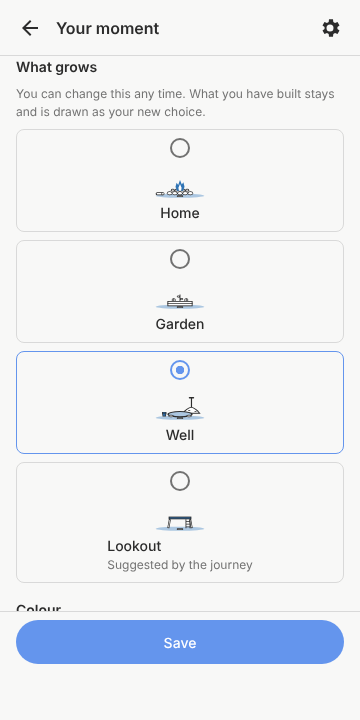     | 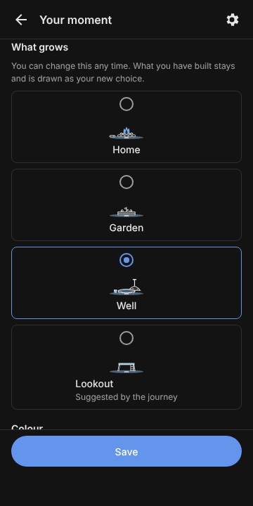     |
| -------------------------------------------------------------------------------- | ------------------------------------------------------------------------------ |
| 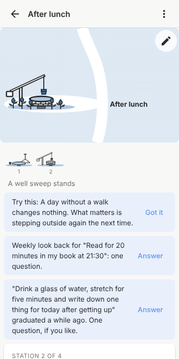 | 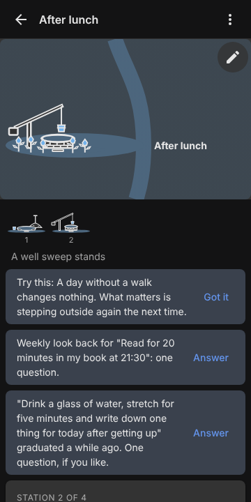 |

### 3b. Plan check

**Plan check** in the journey's menu (screen 4) opens the same four
fields as their own page, filled with what is stored, to answer later,
change or empty. Main action: **Save**, which rewrites the record
(`checkPlan`) and leads back; with every field empty it withdraws the
record. QuestArc never asks for the plan check by itself.

Where the answers come back: only the plan for the obstacle, as one
line "Your plan for the obstacle: If I reach for the phone, then I will
put it down", in the hard-week hint (flow D) and in the details of
every reached station (screen 5). The other answers are shown on this
page only. They are never written into a task and never sent anywhere.

### 4. Journey

Opened from the growing step of a moment (screen 0); back leads there.

- Top: the place's name (the journey's title for a journey from before
  anchors); menu (Pause or Resume, End journey, **What you
  build** (screen 3a), **Plan check** (screen 3b), **Stations**, Shelf,
  Settings). **End journey**
  happens at once and offers **Undo** (it writes one record, withdrawn
  by Undo).
- **The build** (#100, #110, #130, [journey
  design](journey-design.md#the-journey-screen-with-the-build)). The
  title is the place's name. The upper part is the **place piece drawn
  large** (screen 0b) in the place's hue instead of the ladder's own
  setting: every thing of the place where it stands (the second and
  third behind the first, #151); the one this journey builds (the
  place's first thing, or, for a further journey, its own: [game
  rules](game-rules.md) §8, a further journey builds another thing of the
  same kind from version 1) in its current version, and the marker
  standing at its foot in front of every thing, mapped onto that thing's
  box (so it never crosses the path and nothing hides it), with its first
  `ceil(markerProgress × E)` elements, all hanging elements "on" while
  ready. The pencil on it opens "Change this moment" (screen 0a). A
  journey from before anchors has no place yet: it stands on a place made
  from its own build, with no pencil. A journey beyond the place's three
  things builds none: it shows the place only, without the row of
  versions and the line of state. The menu has **What you build** only
  for the place's first thing (a further journey's ladder is the first
  one's).

  | 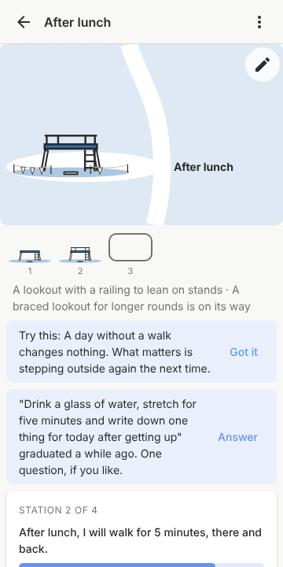 | 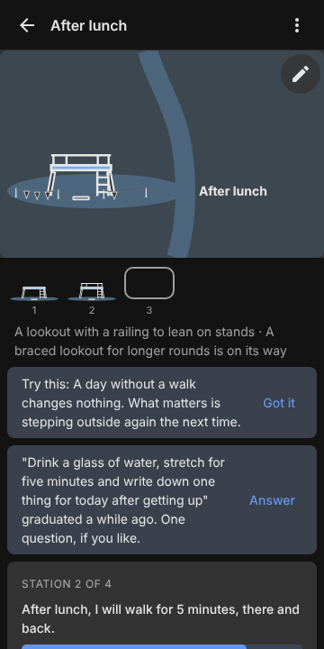 |
  | ---------------------------------------------------------- | -------------------------------------------------------- |

  Below the place the row of
  versions (the standing ones as small pictures with their number,
  nothing further: no box or step for the next version), then one
  line of state in words, only what stands ("A hut stands", never "… is
  on its way" or "… is ready", #155; the journey's own version names only while the run's ladder is the journey's own, else the ladder's titles, #115), then the card. The picture's text for
  screen readers says the same and the flowers in words: "A hut,
  version 3 of 5; 3 of 6 flowers, in bud; not ready yet" ("6 of 6
  flowers, open; ready" while the stage is met; only "A hut, version 3
  of 5" before the first flower). At 720 px and wider the build is on the left and the card on the
  right. There is no drawn path any more: the stations are a list
  (**Stations** in the menu), each opening its details (screen 5).

- **The moment of the tick:** while the screen is open, a completion
  that adds marker elements makes them appear with a short calm
  animation (grow and fade in, about half a second), a new version
  likewise; none with `prefers-reduced-motion`. A redraw without a change
  animates nothing; opening the screen animates nothing.
- Bottom card, the current station:
  - the plan sentence, with the user's pairing if there is one;
  - progress of the condition in words and a bar ("4 of 5 days in the
    last week");
  - "Current run 6 · best 9 · 23 in total"; a gap is shown as a gap, not
    as a loss;
  - the main action, depending on the state:

| Station state                   | Main action                                         |
| ------------------------------- | --------------------------------------------------- |
| unbound (no recurring task yet) | **Set up the task** (flow B)                        |
| unsupported repeat              | **Change how often** (explains the supported kinds) |
| current, condition not met      | none: the habit is done in the task list            |
| met                             | **Continue** (flow C)                               |
| met, the user stays a while     | **Continue** as a quiet action (flow C)             |

- After a long break (flow D) one card stands on top of the station's
  card instead of the banners below.
- A banner on top of the card when needed: paused (with **Resume**, or a
  note that the repeat is paused in Super Productivity), a hard week
  (flow D, with the user's reason and their plan for the obstacle), weekly look back due (**Answer**), the
  station's learning nugget once on arrival (**Got it**), the task's
  reminder when nothing else is said (flow H), and, for the
  habit a finished journey left (flow F), at most one each: the
  question after graduation, the offer to graduate, or its weekly look
  back. The same habit banners stand on the home (screen 0). Dismissing a banner and skipping the weekly
  question are remembered on the device only; they are not choices.
- The card also shows the user's own reason, if they gave one. While
  the user stays at a met station it says "You are staying here a
  while. You can continue whenever you like." After a step back
  (flow D) it says "You started smaller on 13 Nov. The larger step
  waits for you. Tick off the task in your task list as usual."
- In the row of versions a version that stands for a skipped stage
  carries the words "already yours" under its number (flow B); in the
  **Stations** list such a station says "Already yours". A station the
  user left to start smaller (flow D) says "Waiting for you".
- **Read-only journey:** when the active journey is read-only
  ([data model](data-model.md) §2: written by a newer QuestArc, or its
  journey or journey version is not here), the screen shows its title
  (or "This journey" when the journey is not here) and one calm
  sentence instead of the build: "This journey was continued with a newer
  QuestArc. Update QuestArc here to go on with it; nothing is lost." or
  "This journey is not available here. Update QuestArc here to go on
  with it; nothing is lost." No progress, no main action, no Pause or
  End journey; the menu keeps Shelf and Settings. Nothing is written for
  it. It stands at no moment, and while it is the active journey its
  page takes the place of the home.

### 5. Station details

- Arrival story (if any), the plan sentence, schedule, condition, the
  learning nugget as a card titled **Try this**.
- Finished stations show the day they were finished, and their best run.
- A skipped station (flow B) shows its story, plan and nugget like any
  reached station and "Already yours: passed on 3 Nov without a task.",
  neutral, neither done nor a gap. While the engine says the skip can be
  taken back (`undoable`), **Do This Station After All** withdraws it
  and the station is offered again.
- The current station also has the field **Pair it with** (flow B,
  step 6), filled with what is stored: changing it rewrites the record,
  emptying it removes the pairing. Finished stations keep theirs in the
  plan sentence.
- A reached station shows the user's plan for the obstacle from the
  plan check, if there is one: "Your plan for the obstacle: …"
  (screen 3b).
- A station the user left to start smaller (flow D) says "You left this
  step on 13 Nov to start smaller. It keeps what it counted and waits
  for you."

### 6. Weekly look back

- Shown once per week when the user opens QuestArc and the current stage
  is at least 7 days old; never as a notification.
- The last 7 due days as marks: done, gap, not due, paused (shape and
  label, not only colour); current and best run.
- The answers so far as a row of seven-step marks, week by week, the
  latest twelve weeks at most; a skipped week is an empty mark. Under
  it "Easier than four weeks ago." or "About the same as four weeks
  ago." when the engine says so (`answers.trend`), and nothing when the
  answer is lower. No target line, no number to reach. Each mark has a
  text ("Week 45: 5 of 7", "Week 44: no answer").
- One question, the habit filled in: "**Walking after lunch** is
  something I do automatically" with 1 (not at all) to 7 (completely).
- Actions: the seven answers, **Skip**.
- The same screen asks about the habit a finished journey left (flow
  F), reached from its banner or from the shelf, with that habit's
  last due days and run.

### 7. Shelf

- Waiting journeys, with **Resume**.
- **Habits that stay**: the habits of finished journeys that are still
  followed: plan sentence, the last 7 due days as marks and "Current
  run 53 · best 53 · 53 in total" (the run of the last stage, carried
  on past the journey's end, #66; a gap is a gap, never a loss),
  "Keeps repeating as a normal task.", and
  quiet actions when they apply: **Let It Graduate**, **Weekly look
  back**. A habit whose task no longer repeats says so and offers
  **Set up the task** (flow B for that habit); one that was brought
  back says "Back with you since 11 Nov. Nothing was lost."
- **Running by themselves**: graduated habits: plan sentence, "Runs by
  itself since 28 Oct." instead of days and a run, and one action: **Answer One Question** while
  the question is due, else **Bring It Back**; both open the same page
  (flow F). After "not really" the entry says so, without blame.
- Finished journeys: title, start and end day.

### 8. Settings

- **Show the build in the side panel** (off by default, on
  this device only). On, Super Productivity gets QuestArc's side-panel
  button (next to the play button; in the bottom bar on a phone), which
  opens QuestArc's page beside the task list, so the build is in view
  while ticking off. Off takes effect at Super Productivity's next start,
  because a plugin cannot remove that button ([Super Productivity
  facts](super-productivity-facts.md) §7); the text says so.
- "How QuestArc motivates you".
- **Remove QuestArc's data**: withdraws all of QuestArc's records, never
  tasks; it cannot be undone, so it asks first, in place.
- Data: "QuestArc stores only your choices (journeys, accepted stages,
  answers) with your Super Productivity data. Removing the plugin deletes
  them on all your devices."

The settings button of QuestArc in Super Productivity's plugin list
(Settings, Plugins; 19.3.0 and later, `registerConfigHandler`) opens the
view straight on this screen, with the previous screen under it so back
leads there. Where the host has no such button nothing changes: the
settings stay in the view's menu.

### 9. How QuestArc motivates you

Plain words, one paragraph each: small steps that grow (reaching a
station is not the same as the step feeling easy, so staying is always
possible and the weekly answer suggests when to go on; a step the user
already does can be passed and counts nothing); one plan "after
X, I will Y"; the user's moments, not a list of habits: a moment that
already exists in their day, in their words, one step growing at a
time and only that one ticked off, what runs by itself standing at its
moment in one line without a box, so the list gets shorter, and the
next step starting from the same moment or, by choice, from a step
that already runs there; one missed day is fine, two in a row start a new run but
never end the journey; welcome back after a gap; after a long break
(nothing counted for two weeks) QuestArc asks how to go on: carry on,
call the time a pause, or take up the smaller step before again,
nothing built is taken away, and the two weeks are QuestArc's choice,
not a number from a study; the weekly question, with the answers so
far and no number to reach; reminders are the user's: QuestArc sends
no notifications, asks once whether a reminder on the task would help
for the first weeks, says when it may not be needed any more and never
turns one off; what runs by itself needs no ticking: the
task stays the user's, the habit of a finished journey can graduate
when the answers stay high, it was done on four of five planned
days and its task has no reminder, QuestArc then stops following it and the list gets shorter, the
user ends the repeat or keeps it quietly, QuestArc asks after two and
six weeks and then at most twice a year, the habit can be brought back
without a loss, and the numbers are QuestArc's choice, not a research
result; every journey builds something
that grows with real progress. What QuestArc does not do:
random rewards, rankings, punishment, collecting data. "Success is your
habit, not how often you open QuestArc."

## Flows

### A. Completing a task

The user ticks off the stage's task in the task list as usual. Within a
second QuestArc shows a short message (snack or toast):

| Event                                                 | Message                                      |
| ----------------------------------------------------- | -------------------------------------------- |
| completion                                            | "Drink a glass of water: done. 4 of 5 days." |
| first completion after a gap or a long break (flow D) | "Welcome back. Your run goes on."            |
| several at once (sync)                                | "3 days done. 4 of 5 days."                  |
| condition met                                         | "Station reached: you can continue."         |

Messages say the real progress in words; they never say what was added
to the build and never give points (#110).

The message carries
the action **Show**, which opens QuestArc's page at the build: the
journey on top of the home, so back leads to the moments (Super
Productivity keeps a message with an action visible longer). Marker
elements and new versions get no words of their own (Amir & Ariely
2008, [research](research.md)): the picture shows them.

The events of one change are joined into one message, so messages after
a sync with many changes are summed up in one. The progress ("4 of 5
days") is the current condition: days, times or minutes.

All texts of screens and messages are in `content/i18n/en.json` (keys
`ui.*` and `event.*`), next to the journeys' texts, so Pensum can use the same
words.

### B. Set up the task

Per [recurring-task setup](decisions/recurring-task-setup.md):

1. "Your plan: After lunch, I will walk for 5 minutes. Suggested: daily."
2. **Create the task**: QuestArc creates the task, titled with the
   plan in short and in the user's words ("My first coffee: drink a
   glass of water"; the title of an existing task is never changed),
   and opens it. "Open
   the task, choose Schedule Task, then Repeat, and set it to: Every day.
   QuestArc picks it up by itself." The station waits until the task
   repeats.
3. Or **Use an existing task**: a picker of recurring tasks with a
   supported schedule.
4. If the schedule is not supported: "Journeys work with daily, every
   few days or chosen weekdays."

In Pensum, step 2 creates the repeat itself.

5. **I Already Do This** (#81), below the choices, with "Is this already
   part of your day? You could pass this station. It shows as already
   yours and counts nothing." The stage is passed without a task
   (`skipStage`) and the same screen offers the next stage. Not offered
   for the last stage of a journey, and not once the station has a
   repeating task.
6. **Pair it with** (#58, design rule 7), one optional text field below
   the choices, not focused: "Optional: something you enjoy and could
   save for this step, like "my podcast". Only you see this." While the
   user types, the plan sentence above shows the result ("…, with my
   podcast."). Leaving the field writes it (`pairStage`); an empty
   field withdraws it. At most 60 characters. Nothing is shown, counted
   or built for filling it in, and nothing asks for it again. It is
   never written into the task's title or notes and never sent anywhere.
7. **A reminder for the first weeks** (#60, flow H), one muted
   sentence below the choices while the station has no task: "Would a
   reminder at the time of your moment help for the first weeks?
   QuestArc sends none itself. You could set a time and a reminder in
   the task's repeat." With a fixed-time moment it names the time
   ("… a reminder at 21:30 …").

### C. Continue to the next stage

1. The station's acceptance story and the next stage's plan sentence,
   with the pairing of the current stage: **Continue** takes it along to
   the next stage (`continueJourney`; confirmed by the owner on
   2026-11-14), where flow B shows it in the field to keep, change or
   remove.
2. Two equal choices (#81): **Continue** and **Stay Here a While**, with
   "Both are fine. Staying costs nothing: everything keeps counting, and
   you can continue whenever you like." The engine's suggestion
   (`offer.suggest`, [game rules](game-rules.md) §4) adds one kind
   sentence and makes that choice the filled button; the other stays an
   outlined button of the same size:
   - `stay` with a weekly answer of 3 or lower: "This step still takes
     some thought. You could give it another week."
   - `stay` without an answer yet: "This step is still new. You could
     give it another week."
   - `continue`: "This step seems to come by itself now. You could go
     on."
   - `none`: no sentence, both buttons outlined.
3. **Stay Here a While** writes the `stay` record and leads back to the
   journey; for 7 days **Continue** there is a quiet (outlined) action
   and the station is not announced again. **Continue** writes the
   checkpoint and accepts the next stage, then flow B for its task.
   From a station the user stepped back to (flow D), **Continue** takes
   up the station that was left instead: no story, no new checkpoint,
   "This is the step you left to start smaller. It kept what it
   counted, and the days in between do not count."; its task is still
   bound, or the journey offers **Set up the task**.
4. "You could end or change your earlier task 'walk for 5 minutes' so
   you don't keep both." with **Open the earlier task**; QuestArc never
   ends it itself.
5. Last stage: the ending story, the journey moves to the shelf, the
   habit stays as a maintained habit and stands at its moment; **Done**
   leads to the home (screen 0).

### D. Hard days

- After one missed due day: nothing special; the gap shows in the card's last days.
- After the second missed due day in a row: banner "A hard week? On hard
  days, doing the earlier step (walk for 5 minutes) counts too." with
  **Good to know**. Doing the smaller step and ticking off the task
  counts as a completion. The banner adds the user's reason, if they
  gave one, and their plan for the obstacle from the plan check, if
  they wrote one ("Your plan for the obstacle: …", screen 3b).
- The next completion is welcomed back (flow A).
- **After a long break** (#82, [game rules](game-rules.md) §5: nothing
  counted for 14 days, the journey not paused, and the station not
  met, or met and the user stays: at a met station only **Continue**
  stands, with its choice to stay, decided 2026-11-14): instead of the banners,
  one calm card on top of the station's card: "Good to see you." "Life
  happens. How would you like to go on?", the user's own reason, and
  three choices as equal outlined buttons, each with one line below
  that says what it does; none is suggested. The card stands alone:
  the user's plan for the obstacle (screen 3b) belongs to the hard-week
  hint and is not on it; it stays in the station's details and comes
  back with the hint after **Carry On**:
  - **Carry On**: "Nothing changes. You go on where you are." Writes
    `carryOn`; the card is closed for this gap and the usual screen is
    back, hard-week hint included.
  - **Call It a Pause**: "The days since 27 Oct show as paused, not as
    gaps." Writes `callItAPause`; the days show as paused in the last
    days and the run stands.
  - **Start Smaller** (only with a finished station before, not a
    skipped one; confirmed by the owner on 2026-11-14): "You go
    back to the earlier step: drink a glass of water. What you built
    stays." Opens its own page: the smaller station's plan, "You could
    take up this smaller step again. What you have built stays as it
    is. The larger step waits for you and is offered again when this
    one is settled.", whether the earlier task still repeats ("It
    counts again from today.") or a task is set up next (flow B,
    without **I Already Do This**; also when the earlier task's repeat
    still exists but has ended by its end date, decided 2026-11-14:
    flow B then says "The repeat of your earlier task for this station
    has ended. You could create a new task or use another recurring
    task."), "The task of the larger step stays
    as it is. Afterwards you could pause or end its repeat in Super
    Productivity so you don't keep both." (afterwards, because pausing
    the current station's repeat pauses the journey), and a checkbox **Also call the days since 27 Oct a pause** (off; the two
    choices combined). Main action: **Start Smaller** (`stepBack`). Back
    changes nothing.

  The build keeps its version; the marker starts again with the smaller
  station. The first completion afterwards is a normal welcome back
  (flow A), whatever was chosen. When the smaller station is met, flow C
  offers the station that was left. QuestArc never changes either task.
  Each station keeps its own "pair it with" (flow B, step 6): the smaller
  station shows the one it had, and continuing from it copies nothing to
  the station that was left.

### E. Pause and resume

Menu → **Pause journey**: banner "Paused since 12 Nov. Paused days don't
count." with **Resume**. Pausing the repeat in Super Productivity has the
same effect.

### F. Graduation

For the habit a finished journey left ([game rules](game-rules.md) §6,
[design rule 25](psychology.md)). Nothing here is pushed, red or
counted down, and nothing is said before it holds.

1. **Until then** the habit is followed as before: its task is ticked
   off in the task list, and once a week a banner says "Weekly look
   back for "…": one question." with **Answer** (screen 6). After
   eight weeks the question comes every four weeks ("A look back for
   "…": one question, every four weeks now.", the page titled "Look
   back"; decided 2026-11-14). The end of
   a journey says "Your habit stays: the recurring task keeps running
   as it is, and the weekly question goes on."
2. **The offer.** When the engine says the habit can graduate
   (`habit.canGraduate`): banner "… seems to run by itself. You could
   let it graduate." with **Have a Look** and **Not Now**. Not Now is a
   choice (`graduateLater`, decided 2026-11-14): the banner is put away
   on every device and comes back four weeks later at the earliest, if
   the habit still can graduate; the shelf keeps the quiet action
   **Let It Graduate** for as long as the habit can.
3. **Let It Graduate** (a page): the plan sentence; what graduation
   means ("QuestArc then stops following it, and there is nothing left
   to tick off for it"); that the thresholds are QuestArc's own choice,
   not a research result (among them: no reminder on the task for two
   weeks), and that staying is just as fine; "If something else still
   reminds you of it, you could wait until you no longer need that.";
   then "What happens to its task?" with two equal choices, none
   suggested:
   - **I Will End Its Repeat**: "QuestArc never changes your tasks. On
     the next page you can open the task and remove its repeat
     yourself." (`graduate` with `end`)
   - **Keep It Repeating Quietly**: "The task stays in your list as it
     is. Ticking it off no longer counts for anything in QuestArc."
     (`graduate` with `keep`)

   Back changes nothing. There is no main action in the bottom bar: the
   choice is the yes.

4. **Runs by itself** (the same page afterwards): what happens now, and
   for the first choice how to end the repeat ("open the task, choose
   Schedule Task, then Repeat, and remove the repeat. QuestArc does not
   do this for you.") with **Open the task** while the repeat exists.
   **Done** leads home. The habit stands on the shelf under "Running by
   themselves" and produces no messages any more.
5. **One question** 2 and 6 weeks later, then at most twice a year
   (`habit.graduated.checkDue`; a question that passed unanswered is
   not asked again; confirmed by the owner on 2026-11-14): banner "… graduated a while ago. One
   question, if you like." with **Answer**. The page asks "Does "…"
   still run by itself?" with **Yes, It Does**, **Not Really** and
   **Not Now** (put away on this device; the shelf keeps it). Yes closes
   the page.
6. **Bring it back** (the page after Not Really, and from the shelf at
   any time): "You could bring this habit back. QuestArc then follows
   it again from today, with the weekly question. The time it ran by
   itself stays as it was: no gaps, and nothing is lost." with **Bring
   It Back** and **Leave It as It Is**. It is a page, not a one-tap
   button, because bringing back cannot be undone with one tap: the
   habit would have to earn its graduation again. Afterwards the shelf
   shows the habit under "Habits that stay"; if its repeat is gone,
   with **Set up the task**.

### H. Reminders

Issue #60, [design rule 23](psychology.md), [game rules](game-rules.md)
§9. QuestArc sends no notifications: a plugin only runs while Super
Productivity is open, and the reminder belongs to the user's task. It
suggests, reads and leads to the task; it never sets or removes a
reminder.

- **At set-up** (flow B, step 7) the sentence above. The task QuestArc
  creates is titled with the plan in short, so the host's reminder
  restates the plan; the title of an existing task is never changed.
- **In a station's first two weeks**, while its task has no reminder
  and no other banner stands on the journey: "Would a reminder at the
  time of your moment help for the first weeks? You could set one on
  the task." with **Open the task** and **Not Now** (put away on this
  device; it is not asked again for this station).
- **Fading** (`reminder.fade`: a reminder is set and two weekly answers
  in a row are 5 or more): "You may not need the reminder any more. You
  could turn it off on the task; QuestArc never does." with **Open the
  task** and **Not Now** (put away for this week on this device). For
  the habit a finished journey left the same banner names the habit, on
  the home, when nothing else is asked about it. When the user turns
  the reminder off, the banner is gone.
- **Graduation** waits while the task has a reminder or had one in the
  last 14 days as far as QuestArc saw (flow F). Both hosts can read the
  reminder of a repeat, so no extra question is asked; what QuestArc
  cannot see (a phone alarm) is left to the user in one sentence on
  the graduation page.
- Day Planner shows the plan sentence only until it has reminders while
  the app is closed (nexumia-de/pensum#13).

### G. Problems

| Situation                                                  | What the user sees                                                                                                                                        |
| ---------------------------------------------------------- | --------------------------------------------------------------------------------------------------------------------------------------------------------- |
| the bound repeat was deleted                               | Station unbound: "The task for this station is gone." **Set up the task**                                                                                 |
| Super Productivity older than the plugin needs             | "QuestArc needs Super Productivity 19.3 or newer."                                                                                                        |
| journey definition changed while walking                   | Nothing, unless the current stage was removed: "This journey was updated; you continue at …"                                                              |
| no moment yet                                              | Empty state with **A New Moment**                                                                                                                         |
| plugin.js not running yet (app start, update, switched on) | "QuestArc is starting. This page updates by itself in a moment." The view retries every second                                                            |
| plugin.js still not answering after 20 s                   | "QuestArc is not running. Check that it is switched on in Settings → Plugins, then reload Super Productivity."                                            |
| plugin.js answers with an error                            | "QuestArc could not read your data. It tries again every few seconds. If this message stays, reload Super Productivity." and "Details: …" with the reason |
| a page whose journey or station is gone                    | "This page is out of date: the journey or station changed. Go back to continue."                                                                          |

These messages stand between the header and the screen and go away with
the first answer, also when the data did not change in between.

## Where it lands in each host

| Part               | Super Productivity plugin                                                         | Pensum                                       |
| ------------------ | --------------------------------------------------------------------------------- | -------------------------------------------- |
| Entry              | header button with the route icon                                                 | header bar of the main window                |
| Home and journey   | plugin view (`showIndexHtmlAsView`): the moments, the journey pushed on top       | sidebar page; details pushed with swipe back |
| Station details    | page inside the view                                                              | pushed page                                  |
| Bound task actions | task context menu "Use for current station"                                       | row menu "Use for current station"           |
| Messages           | snack (`showSnack`) with the action **Show** (opens the view)                     | toast                                        |
| Build at a glance  | optional side panel (setting, off by default): the same view beside the task list | strip at the top of Today (later)            |
| Settings           | settings screen of the view; the plugin list's settings button opens it (#67)     | preferences                                  |
| Main actions       | bottom of the view                                                                | bottom bar (thumb reach)                     |
