# Journey design

Decided on 2026-11-05 (#15) by best practice, as the owner asked, and
changed on 2026-11-13 (#110): there is one look. Every journey shows
what it builds; the drawn path with its stations, the calm and the game
variant, the level chip and the guardians are gone. The screens around
it are in [behaviour](behaviour.md).

## Layout

| Phone                                               | Desktop                                                 |
| --------------------------------------------------- | ------------------------------------------------------- |
|  |  |

- **Phone (360 px):** the build fills the upper part ([the journey
  screen with the build](#the-journey-screen-with-the-build)); the
  current station's card sits below it with the plan, the condition and
  the last seven due days.
- **Desktop and wide windows:** the build on the left, the card on the
  right.
- The stations are a list (**Stations** in the menu): number, name and
  state in words, each opening its details (plan, schedule, condition,
  learning nugget, arrival story).
- No map, no characters, no avatar to customise. The colours come from
  the host: in the plugin from Super Productivity's theme variables, in
  Pensum from libadwaita's accent and named colours, both in light and
  dark style.

## Last seven due days

A row of marks in the card, oldest left; the engine reports them as
`lastDays` of the current station ([data model](data-model.md) §3):

| Day        | Mark                                                                                   |
| ---------- | -------------------------------------------------------------------------------------- |
| done       | filled circle                                                                          |
| gap (miss) | hollow grey circle with a dash                                                         |
| open       | dashed ring (today, or yesterday not yet ticked off: still inside the backfill window) |
| not due    | not shown (only due days are listed)                                                   |
| paused     | two short bars                                                                         |

Weekday letters below each mark. A gap is grey, never red, and no count
falls to zero; the run text ("Run 4 · best 6") stays next to the marks.

## Accessibility

- Every state has a shape and a text, not only a colour.
- Touch targets at least 44 × 44 px.
- Texts follow the system font size; the card grows and scrolls.
- Screen readers get the build as one sentence and the stations as a
  list in journey order with their state.

## Builds and ladders (the Valley, #42)

**Up to three things of one kind at a moment** (owner, 2026-11-15, #148).
A further journey from the same moment builds another thing on the
**first journey's ladder**, starting at version 1; at most three things
stand at a place (`THINGS_PER_PLACE`), a fourth journey builds none.
There are no surroundings. The second and third stand behind the first
([the place piece](#the-place-piece-the-valley-127), #151).

Decided by the owner on 2026-11-12[^42]: a journey builds **one thing**,
whole at every stage, and every stage makes it a larger version. A
**ladder** is that thing drawn once in five versions and used by every
journey that picks it. The ladders are Home, Garden, Well and Lookout
(#128). The sequences below were taken before #152 with the retired
markers (pennants, lanterns, vines on posts); the flowers that replace
them are under "Markers" below. Plugin light above, Day Planner dark
below (scale 2).
The first ladder, Crossing (a river: stepping stones to a covered
bridge), was retired by #128: the Valley has no water (owner,
2026-11-15). Each version, then its marker growing element by element
(every element for the first stage, a few sampled steps for the
others), ready, then the next version:

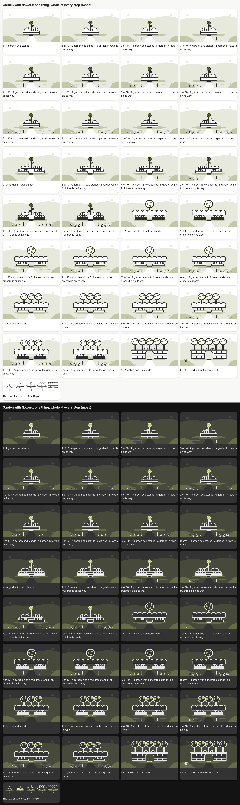

Garden's five versions at the journey screen's size (360 px wide) and the
row of versions at 60 × 40 px, plugin light above, dark below, and the
journey mock at 360 × 720 (mid-way and ready, light and dark):

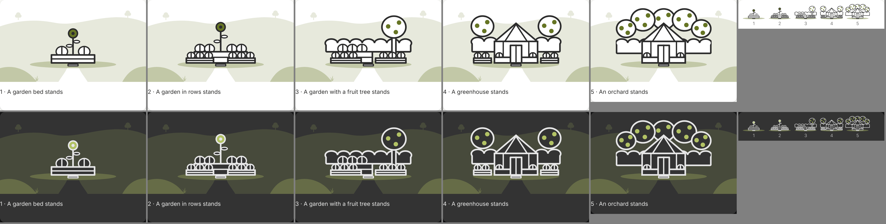

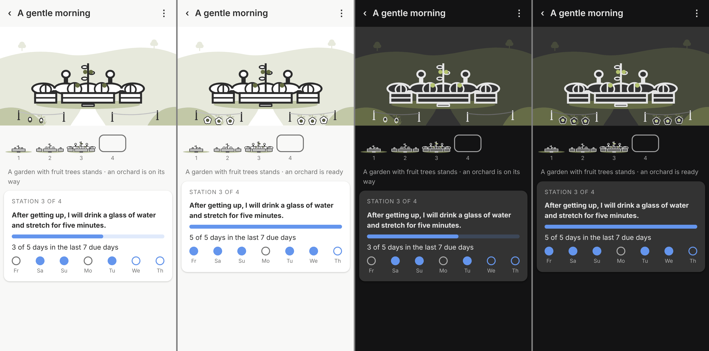

Well the same way: the sequence, the versions with the row, the journey
mock.

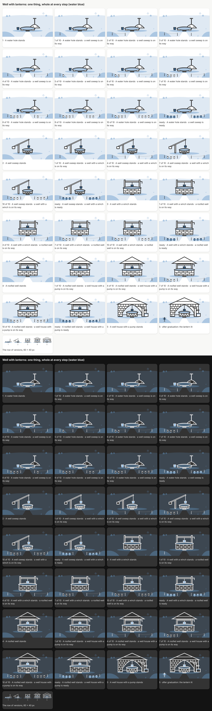

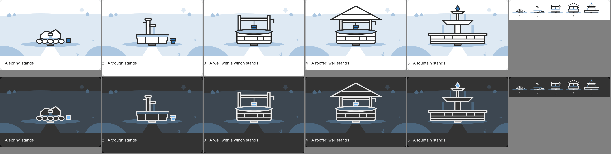

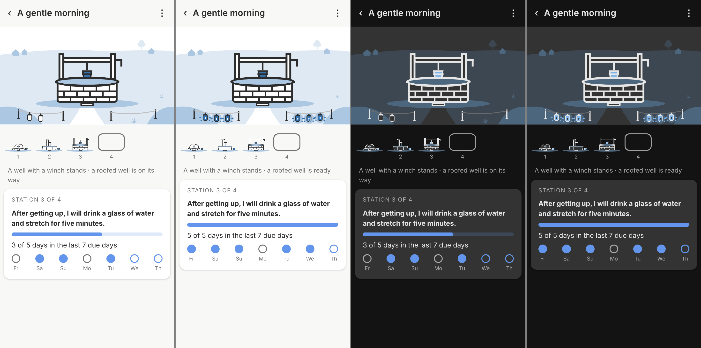

Lookout the same way:

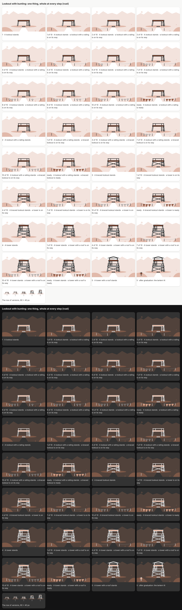

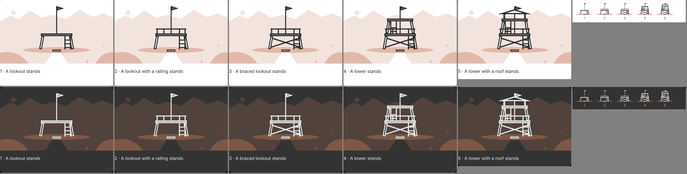

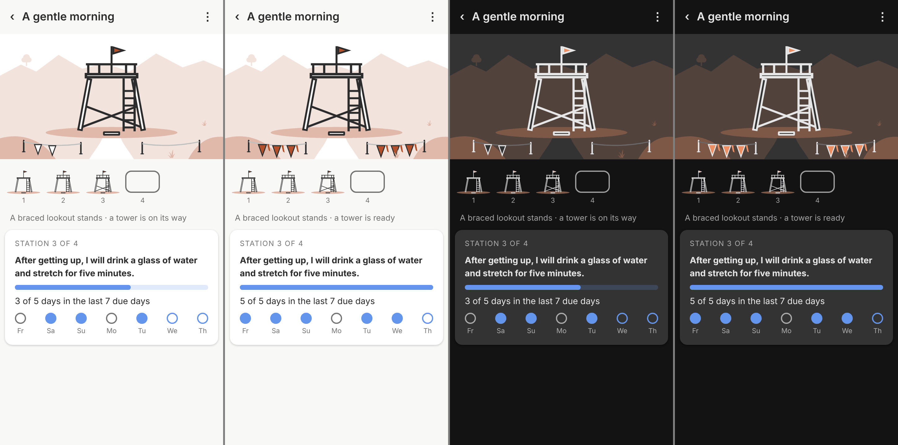

The journey screen as a static mock (plugin and Day Planner side by side;
the retired Crossing above, Home below; first mid-way, posts up and two elements
hanging, then ready), light and dark: the build on top, the row of
versions below it, the state in words, the card unchanged.

| Light                                                          | Dark                                                         |
| -------------------------------------------------------------- | ------------------------------------------------------------ |
|  |  |

**Files.** A ladder is `content/art/<ladder>.ladder.json` with its title,
the default hue, whether its setting is water (`water`: a build on water
reaches its box's lower edge), the versions (`build-<ladder>-<n>.svg`, each with a
title), optionally the part of every version the row of versions shows
(`row`), the way points (`ways`) and the setting with its places,
including the marker's flowers; the setting is `setting-<kind>.svg`. Checked by
`ladderProblems` (`packages/engine/src/art-ladder-check.ts`) in
`npm run journeys`. The coordinates of every ladder come from
`scripts/draw-ladders.mjs`: change the numbers there and run it, never
edit the generated files by hand. Outlines, cut-outs and stonework are
built with a geometry library (`scripts/ladder-geometry.mjs`), and the
script measures every version before it writes
(`scripts/ladder-checks.mjs`): the thing inside its box, at least 5 % more
area than the version before, the threshold stone free; a ladder that
breaks one is not written, and `npm run journeys` measures the committed
pictures the same way ([decision](decisions/ladder-geometry.md)).

**Rules for drawing a ladder** (a new ladder comes by pull request like a
journey):

1. **Whole at every step.** Each version is a complete thing (a log, a
   plank bridge, a hut), never half built. Five versions; each clearly
   the same thing grown: same place, same footprint centre, larger.
2. **Same place, same setting.** Every version is drawn in the build's
   view box `0 0 120 80`, standing on y = 74, centred on x = 60, and
   placed in the same build slot of the setting (210 × 140 setting units,
   1.75 per build unit, base line on y = 140). Switching versions must
   read as the thing growing, not as a new picture.
3. **The way.** A build that carries the way (a bridge, for a later
   ladder with water; the retired Crossing had one) has two fixed way
   points: its walking surface runs between them at the same height in
   every version, and the setting's path ends exactly there on both
   banks, as thick as the surface. A build the way leads to (a
   home or a garden) has one: the threshold stone (x = 53–67,
   y = 74–77.5) in front of the fire, the tent's opening and each door,
   of the garden's bed and the walled garden's gate, or of the lookout, or of the water hole and
   each well, where the path ends.
   `ways` lists them; the checker requires a corner of every version and
   of the setting's path at each way point.
4. **Water runs through** (for a later ladder with water; the Valley's
   ladders have none). Water in a setting runs from edge to edge (a
   river leaves the near edge and bends away to an edge behind the
   build); it never stops in the middle of the scene. The shore's water
   also spans the whole width.
5. **Sizes.** Outlines 2 build units (3.5 px at 360 px, 1 px in the row of
   versions); every version must read at the journey screen's size (the
   setting 360 px wide) and in the row of versions at 60 × 40 px: give the
   smallest versions mass and a clear silhouette (stones with a flat top,
   a curb of single stones), not thin lines. A ladder whose
   small versions are wide and flat may name `row`, a 3 : 2 part of the
   build's view box that the row shows zoomed (e.g. `[30, 38, 60, 40]`;
   no current ladder needs it); the scene always shows the whole build. The largest version may
   reach y = 4; the setting's sky is at most its top fifth.
6. **Bank contact** (for a later ladder with water). A build across
   water rests on the banks at both way points: stone abutments under
   the deck ends or masonry reaching into the banks. No deck floats;
   such a build may reach down into its water to the edge of the box
   (y = 80, `"water": true`).
7. **Growth in size and form.** Each version is larger than the one
   before and also different in form, so the row reads as a story: Home
   is a fire in a ring of single stones, a tent, a hut under a round
   thatch, a cottage with a pitched roof and chimney, a house of two
   storeys. Garden is drawn once from elements with states (#137): every
   element enters at its smallest state and grows one state per version,
   and nothing moves, shrinks or disappears. The middle bed with
   seedlings and a bare stake (1); a bed on each side (2); a low hedge
   and two saplings (3); the hedge full, two more saplings (4); a low wall
   of stones with its gate (5). Plants go seedling → grown → ripe, the
   stake bare → climber → ripe, trees sapling → young → grown → old;
   fruit shows only on what is ripe. Choosing what grows is #138. Well
   follows how water is drawn: a water hole dug down to the water (its
   earth heaped behind with the spade in it), a well sweep (a beam on a
   forked post with a stone and the bucket on a pole) over a low stone
   curb, a round well with a winch, the well under a roof, a stone well
   house with the well inside, under its arch (owner: a spring and a pump
   break the line, a fountain is another use). Lookout is built from the
   bottom up, and what is built stays where it is (a built thing does not
   grow, owner): a low platform on two posts with a ladder, its railing,
   a cross brace under it, the posts carried on up to an upper deck with
   its own ladder, a roof on short posts over the upper deck. The accent
   is the deck you stand on to look out, the top one.
8. **History, step by step** (owner, 2026-11-15). A ladder follows one
   real line of development for one use; each version is what people
   actually built next, within a world before electricity, so the row
   reads as a story without words and no version is a step back. A
   ladder has five versions; a journey with more stages uses the rule of
   game rules §7 (the last version gains fixed additions). Parked: a
   version that is a different technique joining what stands (a hand
   pump at the well house, a greenhouse in the garden), and several
   things at one place
   ([#114](https://github.com/nexumia-de/quest-arc/issues/114),
   decision 13).
9. **Look.** Outlined in `fg` with a `bg` fill, one `accent` detail (the
   flame, a glowing door or window, the keystone, a rail cap, the
   fruit, the bucket, the lookout's top deck), water and
   the yard in `tint-strong` of the region's hue. The setting is quiet:
   ground and far trees in `tint`, a few reused plants (tuft, bush,
   flowers, far trees) in the [depth bands](#look-and-depth-bands).

**Markers: a stage on its way.** While a stage runs, **flowers** grow on
the thing's own ground (owner, 2026-11-15, #114 "Signs and markers,
simplified", #152). They replace the earlier markers (pennants, lanterns
and vines on a line between posts, 2026-11-12, which replaced a scaffold
and a ring around the build): with one marker left there is nothing to
choose, and a lantern means only "runs by itself" (game rules §8).

The place screen at 360 × 720 (scale 2, shown halved): Home, Garden,
Well and Lookout at version 3 with half the flowers in bud, then Well
ready with every flower open; light above, dark below:

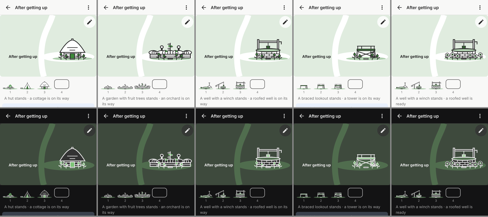

Each thing at 60 × 40 px (versions 1, 3 and 5; three flowers in bud,
then all six open), light above, dark below:

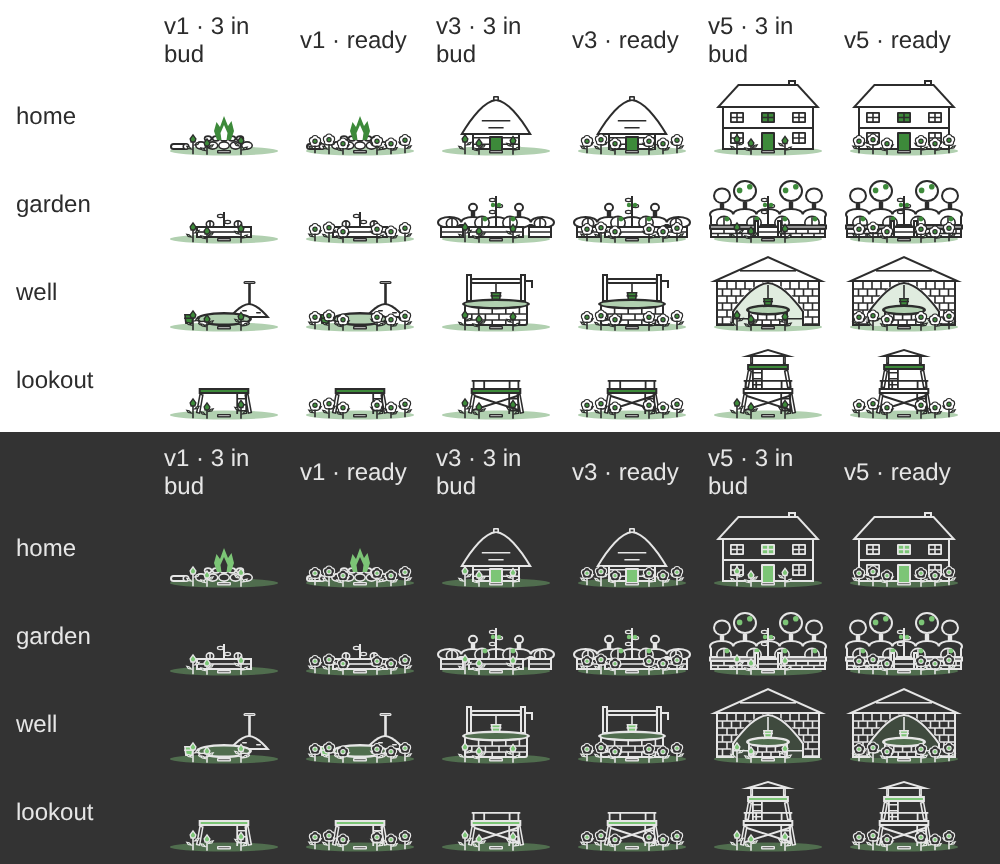

- **Flower by flower.** The marker has E = 6 flowers in a fixed order.
  The hosts show the first ceil(p × E), p (0 … 1) the best progress
  reached in the stage's condition; p = 1 means all stand. So a `days`
  stage (5 of 7) and a `count` stage (20) fill the same marker, and since
  p is the best progress, never the current one, a flower never goes
  again.
- **Bud, then blossom.** A flower is a stem with two leaves and a closed
  bud, its folded petals in the accent. **Ready** (while the condition is
  met now) every bud is an open blossom: five white petals outlined in
  `fg` around an accent centre, different in shape, not only in colour.
  Outlined in `fg` like the thing, leaves in `tint-strong`; the accent is
  the one detail (the bud's petals, the blossom's centre).
- **Where they stand.** On the front of the yard (the thing's ground,
  the ellipse every version stands on, on the bay), three on each side
  of the threshold stone, never in front of the doorstep, at different
  heights, inside the build's box, so never on the path. They grow from
  the doorstep outwards, one side then the other. Drawn once for every
  ladder: each flower is a picture in the build's view box
  (`marker-flower-<k>.svg`, open `marker-flower-<k>-open.svg`), so a host
  draws it in the thing's own box, in front of the thing; nothing moves
  or shrinks, a bud only opens.
- After the last version nothing is on its way: no flowers. On Continue
  the next version stands and the flowers are gone until the next
  stage's first counting completion.

Counts stay where they are exact: the progress bar, the words ("3 of 5
days") and the seven day marks in the card. Under the row of versions
the state is said in words, never as a building site: "A hut
stands", whether the stage runs or is met: never the next version.

**Measured** by `flowerProblems` (`scripts/ladder-checks.mjs`) before
`scripts/draw-ladders.mjs` writes anything: every flower's feet on the
yard, both forms inside the build's box and clear of the doorstep's
column (x 51–69), no two flowers overlapping in either form, each
picture within 4 KB, the order from the doorstep outwards. In the ladder
file each flower is a `marker` place filling the build's slot, listed
right after the build, with its `order` (1 … E); `ladderProblems`
requires at least two, in order, with both pictures. A ladder on water
(none since #128) needs no rule of its own: the flowers stand in the
thing's own yard.

**Slots** in a ladder's setting, filled by the hosts: `build` and
`lantern` (after graduation, lit, on the near ground on the left, where
the marker's first post stood before #152); the `marker` places above
name their pictures. In the Valley the lit lantern stands apart from the
thing beside the doorstep instead
([the sign of a place](#the-sign-of-a-place-the-valley-131)).

**Row of versions.** Below the build: the standing versions as small
pictures (60 × 40 px) and nothing else: no box or step for the next
version, nothing is announced before it is earned (#155, decision 6 of
#114).

**A region is an anchor** (#96, which changes #42: not one region per
journey). Every journey started from an anchor builds on in the same
region, and a new anchor opens a new region, which carries the
anchor's words as its name unless the user gives it another. A
graduated step stands there with its lantern lit, from QuestArc's own
records ([game rules](game-rules.md) §8). The engine already groups its
view by anchor (`anchors`); the regions themselves, the map and the
lantern are drawn with #114. Until then the home lists the anchors in
words ([behaviour](behaviour.md), screen 0), a journey's build is shown
on its own screen as below, and the hue belongs to the anchor's place, not to the run
([game rules](game-rules.md) §8, #126; until the screens follow, the hosts
still show the ladder's default hue).

**Colour per region.** A region's scene takes `accent`, `tint` and
`tint-strong` from one hue of `content/art/palette.json` (eight named
hues, a light and a dark value each); `fg`, `bg` and `dim` stay the
host's, and the path, card and controls keep the host's accent. The
setting's kind sets the default (clearing: meadow green; Garden's open fields: moss; Well's village green: water blue; Lookout's heights: rust). Each hue is checked by computation (WCAG relative luminance) in
both repositories: `accent` at least 3 : 1 against every host card (WCAG
1.4.11, non-text), `tint-strong` at least 1.5 : 1 (decorative, but the
water must show) and the outline `fg` at least 3 : 1 on `tint-strong`;
`tint` is decorative and not tested. Two ladders in two hues each, plugin
light above, Day Planner dark below (taken before #128 with the retired
Crossing and Home; the palette page now shows Well and Home):

**Review rounds** (both hosts, light and dark, journey mock at 360 × 720;
rounds 1–4 still show the dropped pile or scaffold):
[1, crossing](screenshots/ladder-round-1-crossing.png) and
[home](screenshots/ladder-round-1-home.png): the build too small, the
river a straight wedge, beams like drawers;
[2](screenshots/ladder-round-2.png): larger slot (1.75), river bends at
the near edge, hut redrawn; [3](screenshots/ladder-round-3.png): river
behind a fold, wider pile columns (the pile was later dropped);
[4](screenshots/ladder-round-4.png): the owner's corrections: the path
meets the crossing and the door at fixed way points, the river runs edge
to edge, the scaffold and flag instead of a pile. Markers (both hosts,
journey mock light): [m1](screenshots/ladder-markers-round-1.png) a ring
of posts around the build: the abutments looked like boats, too many
lanterns, the flame a tree; [m2](screenshots/ladder-markers-round-2.png)
brick abutments, a rounded thatch for the hut, the row zoomed;
[m3](screenshots/ladder-markers-round-3.png) the owner could not read the
ring's steps in order (a line behind the build looked odd, ready was a
colour only): superseded by a gate across the path, then by the marker
that grows element by element; [m4](screenshots/ladder-markers-round-4.png)
element by element, `span` and `sides`: the posts looked like
stanchions, and the scenery flowers read as a hanging element;
[m5](screenshots/ladder-markers-round-5.png) slimmer posts, larger
elements; then the owner asked for plain posts with nothing on top and
ready only on the hanging elements; [m6](screenshots/ladder-markers-round-6.png) plain posts, but the `span` middle post stood in the water: now two posts, one on each bank, and one line across: the sequences above. Posts, lines and hanging elements were retired by #152 (flowers in the yard).

## The place piece (the Valley, #127)

The Valley ([#114](https://github.com/nexumia-de/quest-arc/issues/114),
decisions 2, 7, 8 and 9) is one scene made of **place pieces**, laid out
by rule and never drawn by hand: `valleyLayout` in
`packages/engine/src/valley-layout.ts`, pure and shared by every host
(Pensum asks `engine-cli.mjs` with `{ "valley": { "sides": […] } }`). It
takes the side of the path each place's thing stands on, in the order of
the day, and the scene's width and height, and returns:

- **the path**: one centre line from the top edge to the bottom edge, no
  start, no goal, drawn 22 wide in the host's background. Each place is a
  bend `20 + 6 n` to the side away from the thing (n places, at most 56),
  so one place leaves it almost straight; between bends a smooth S-curve
  (control points half a spacing long). Before the first and after the
  last place the curve goes on as if the sides kept alternating and is cut
  at the scene's edges.
- **the places**, evenly spaced: six fill 360 × 720; with more the scene
  is longer (120 per place) and scrolls; at 720 and wider the same scene
  is drawn larger (all numbers times width / 360), not rearranged. The
  bends sit a little below the middle of their spacing (by at most a
  quarter of it), because a thing stands above its bay.
- per place the **slot**, the build's box (`0 0 120 80`, base line
  y = 74) wholly on the thing's side, and its **plot**: the slot with
  14 build units of room towards the path, where the lit lantern stands
  apart from the thing (#131, owner 2026-11-15), as high as the slot.
  The plot's near edge stays at least 15 from the path's centre line
  wherever the path comes nearest; one scale for every thing, the
  largest at which each plot fits the scene (at most 1.75, the journey
  screen's): 1.36 with one place, 1.29 with three, 0.97 with six and
  more (1.51, 1.40 and 1.04 before the lantern's room was kept);
- the **bay**: an ellipse in the path's colour from the centre line at
  the bend to the slot's far side, 14 build units high on each side of
  the bend, on the thing's side only; the build's own yard lies on it;
- the **doorstep**: the threshold stone's top (x = 60, y = 74 of the
  build), 4 build units below the bend, on the bay;
- the **name** box on the free side at the height of the bay, from the
  scene's edge (8) to 15 from the centre line: two lines of 14 on 18 at
  most, then an ellipsis; the block hugs the path (`align`), its lines
  start left (Chromium drops the ellipsis of right-aligned clamped text);
- per place **every thing's box**, front to back (`things`; the input
  `things` gives how many stand at each place, one to three, #151): the
  first is the slot and never moves for the ones behind. The second and
  third stand **behind** it, side by side in a row (owner, round 2):
  higher on the ground (their base lines 72 build units above the
  first's, so their feet stand above the roof of the first's tallest
  version and a small growing version and its flowers stay in view),
  about two thirds of the first (0.64, the far band), the second at the
  edge of the first's box away from the path, the third right beside it
  towards the path (4 build units apart, `besideGap`), reaching across
  the first's inner edge above the lantern. Neither covers the other:
  where the path comes nearer than `clearance`, both are drawn smaller
  until they fit side by side. Measured, the room beside the path is
  about 1.12 of the first's width (the first and the lantern's room), so
  with three things the two behind are 0.40 to 0.54 of the first; a
  second thing alone keeps 0.64. Each thing behind stands on its own
  **ground patch** (`patches`), drawn like the bay in the same colour:
  an ellipse under its base line, as wide as the thing and 14 of its
  build units high on each side, never on or across the path. The
  doorstep and the lantern belong to the first. The first things keep
  the size they have without the ones behind; where the band above a
  place is taken (the scene's top, another place's name or plot) the
  scene grows there by what the things behind need, so six places with
  several things scroll a little;
- **joints** where the path crosses the piece's upper and lower edge and
  the path within the piece, so a single piece can be drawn large as the
  setting of the place screen.

Colours (decision 9): outlines, fills and names `fg`/`bg`; path and bay
the host's background in the light theme and, in the dark theme, the
place's `tint-strong` (so a bay reads as the path widening, not as a hole
in the lighter ground; #129); the ground each place's `tint` (16 % of its hue),
passing into the next place's around the joint; the thing's one `accent`
in the place's hue. No decoration without a job: no flags, no stones
without a use, no water, no bridge; nothing crosses the path.

**Checks** in `npm run journeys`: `valleyProblems`
(`packages/engine/src/art-valley-check.ts`) measures the layout for 1 to
12 places with the things alternating from either side, every choice of
sides up to six places and the scene at 720 wide: no plot and no name box
comes nearer than 15 to the centre line or leaves the scene, every slot
lies in its plot, no two boxes overlap, a name box holds at least 5.5 characters and two lines, every bay stays on its
side of the centre line at every height and reaches the slot's far side,
the doorstep lies on the bay, the path runs edge to edge. With one to
three things at each place (#151; every count and mix for 1 to 12
places from either side, every choice of sides up to six, at 720, 480
and one place's 230 high, and at 720 wide): every thing behind stays in
the scene, 15 from the centre line and clear of every other place,
stands higher and smaller than the first and overlaps its box, covers no
other thing behind, stands on its own patch under its base line that
keeps 3 from the path's edge, stays in the scene and overlaps no other
patch; none covers the doorstep or the lantern's room (the plot beside
the slot from the lantern's top, 48 build units, down), and every thing's
flower band (its box's lowest 20 build units) stays in the scene, clear
of the lantern's room, the name and every other place. The flowers are
drawn in front of every thing, so nothing hides it. The palette
check (`art-palette.ts`) requires the hosts' text on every hue's `tint`,
and where two hues' tints blend, at 4.5 : 1, light and dark, on every
host card; the tint itself is decorative and not tested.

**Pictures** come from `scripts/draw-valley.mjs` (the layout with the
committed builds in its slots, rendered in Super Productivity's card
colours, light left, dark right; example words and hues):

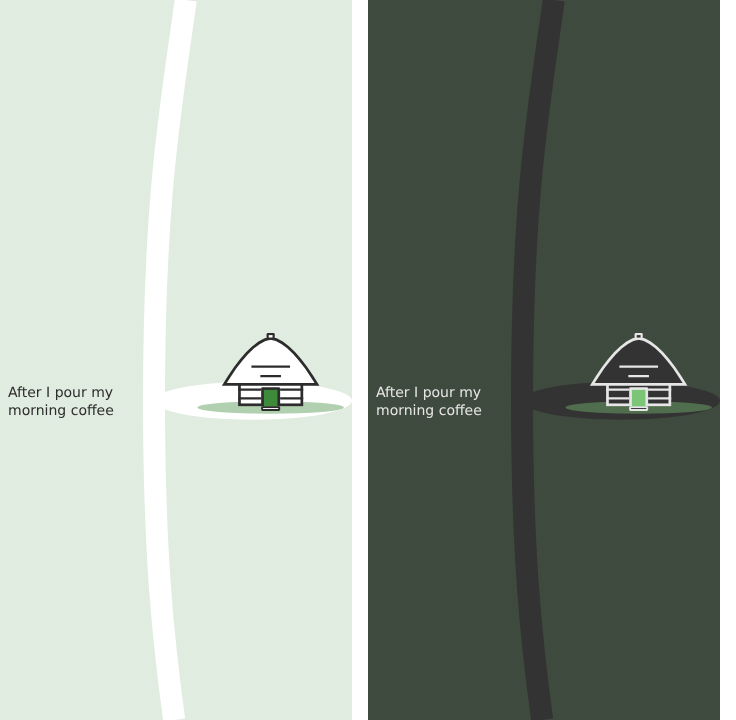

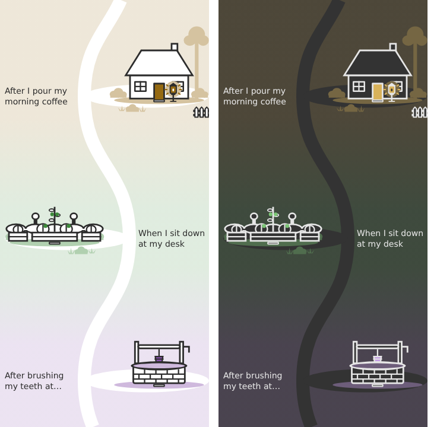

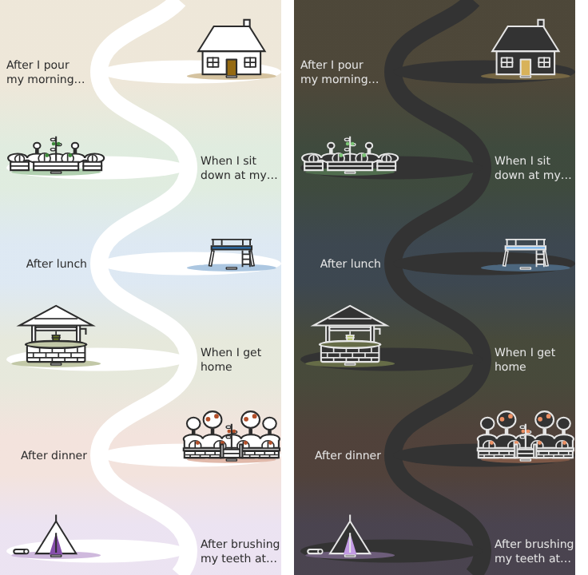

Six places with two and three things (#151), and one place with one,
two and three things as its page draws it (230 high; light above, dark
below):

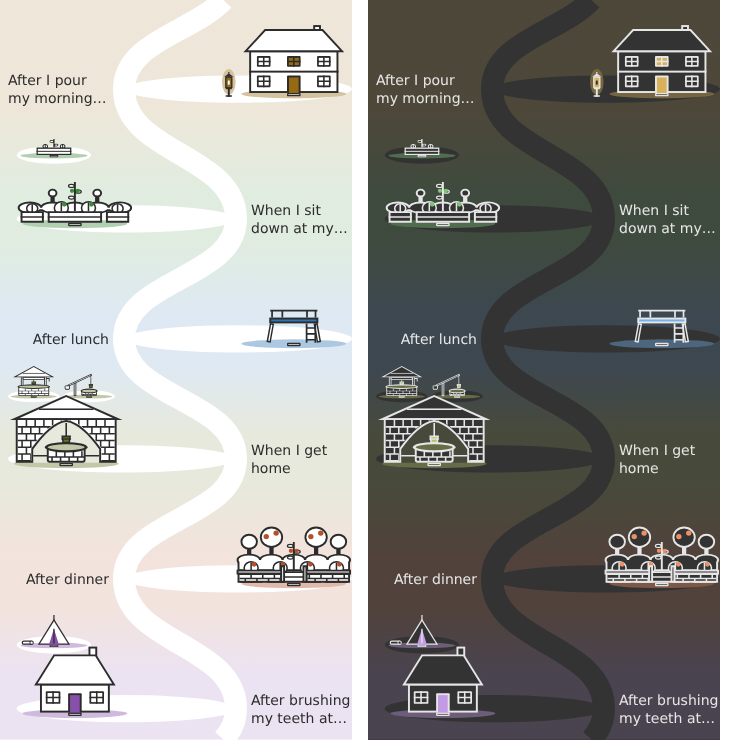

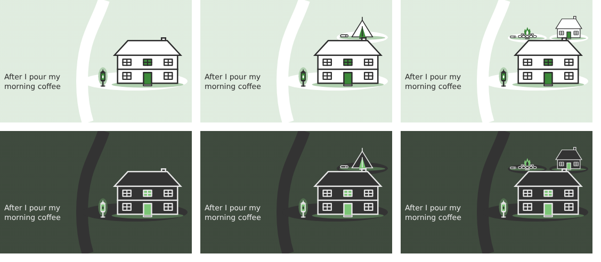

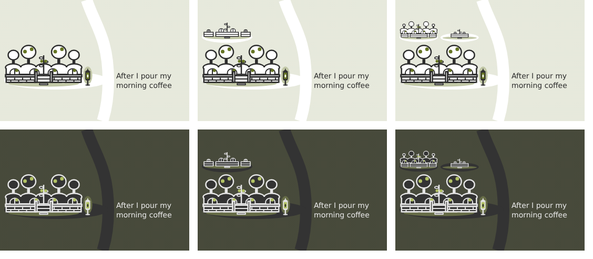

In the plugin (demos `place-home-1` … `place-garden-3`, the last journey
growing, its marker in view): [Home](screenshots/valley-place-home-things-phone.png)
and [Garden](screenshots/valley-place-garden-things-phone.png) at 360 × 720,
[Home](screenshots/valley-place-home-3-desktop.png) and
[Garden](screenshots/valley-place-garden-3-desktop.png) with three things
at 1000 × 700.

The same scenes drawn at 720 wide in a 1280 wide window:
[one](screenshots/valley-desktop-1.png),
[three](screenshots/valley-desktop-3.png),
[six](screenshots/valley-desktop-6.png).

## The sign of a place (the Valley, #131)

What a place shows after its thing[^131] ([#114](https://github.com/nexumia-de/quest-arc/issues/114),
decision 5 as the owner simplified it on 2026-11-15, "Signs and markers,
simplified"), drawn once and fitting every thing, from the engine's
`valley` view ([game rules](game-rules.md) §8): its `sign`. Nothing is
shown before it is earned, and no screen lists what is still to come.

**The lit lantern** is the place's only sign: it stands there when a
routine at the place runs by itself (`lantern`), after which nothing is
counted or changed any more. A lantern on a short post, about as high as
the thing's door at the thing's scale and line weight, standing clearly
apart from the thing on the bay's edge beside the doorstep, towards the
path. Lit, its glass is filled with the light (`accent`) with a flame in
it (`bg`), and a calm halo stands behind it: a soft filled shape in
`tint-strong`, no rays or dots. (The unlit lantern of the marker is
retired with #152, so a lantern only ever means this.) The same lantern, scaled, stands in a ladder's
`lantern` slot on the journey screen. A routine still followed shows no
sign (flowers are the marker's one kind, #152).

**Where it goes.** The place piece keeps 14 build units of room towards
the path beside every slot (the plot,
[above](#the-place-piece-the-valley-127)), kept whether or not a place has
a lantern, so nothing jumps when it is lit. The lantern is drawn in the
build's units in the thing's own box and reaches beyond it into the
room (frame `-14 0 148 80`: the build's box with 14 units on either side),
one picture for each side of the path (`place-lantern-right` left of the
box for a thing on the right of the path, `place-lantern-left` right of
it), so a host only places it and mirrors nothing.
`content/art/place.json` names the frame and the two lanterns.

**Layers**, back to front: ground, path and bay, the thing, the marker,
the lantern, the name. The Valley's scene
(`packages/ui/src/ui/valley/scene.ts`), which draws the home and the
place's pages, draws a place's thing and its lantern in one loop, each
in the thing's own box. On the place's pages the marker stands in front
of the thing, inside its box; the lantern stays clear of it. The place's
words for screen readers name the sign ("The lantern is lit: the routine
runs by itself.", `ui.valley.sign.lantern`). The plugin bundles the
lanterns with the ladders' pictures (`ladderArt`) in `plugin.js`; the
view carries only the few lines that place them.

**Checks.** `scripts/draw-ladders.mjs` writes nothing while
`placeProblems` (`scripts/ladder-checks.mjs`) finds one, and
`packages/engine/test/art-geometry.test.ts` measures the committed
pictures the same way:

- every picture inside the frame and at most 4 KB;
- each lantern beside the box towards the path, clear of the doorstep
  and the threshold stone, of every version of every ladder (nothing
  overlaps the thing), and of every flower, in bud and open, in the
  thing's box (nothing hides the marker);
- in the Valley's layout (`valleyLayout`) for one to six places on every
  choice of sides and seven to twelve alternating, at 360 and 720 wide:
  every lantern inside the scene, off the path (its stroke and 2 more on
  each side) and clear of every other place's slot, name and lantern, and
  of its own name (nothing hides the lantern).

**Pictures** from `scripts/draw-valley.mjs`, one place at 360 × 720 in
each state: plain, and with its lantern lit; light above, dark below.
Home's house on the right of the path, and the walled garden on the left:

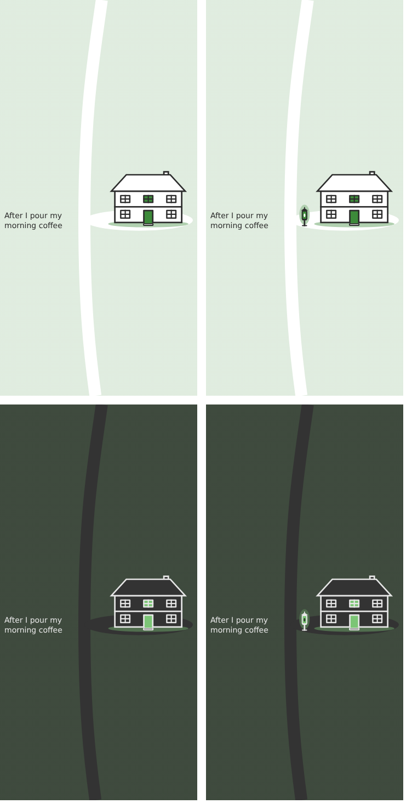

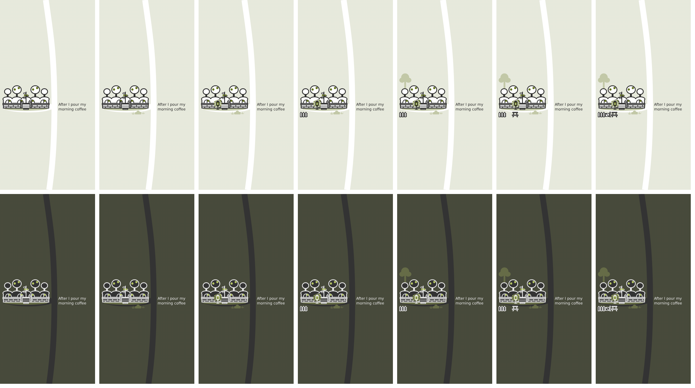

The same states for every ladder's first and fifth version, the build's
box at 60 × 40 with the plot's room towards the path, light left, dark
right:

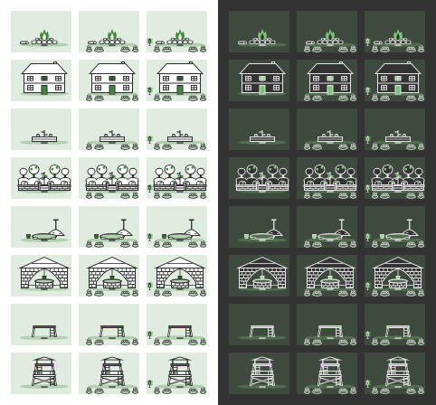

The Valley pictures above show the lantern at some places (three places:
the first; six places: the first and the fourth).

In the home itself (the plugin's preview, demo data, `valley-1`, `-3` and
`-6`), the lantern as the scene draws it, light and dark:
[three places at 360 × 720](screenshots/valley-home-3-phone-light.png)
([dark](screenshots/valley-home-3-phone-dark.png)),
[six places](screenshots/valley-home-6-phone-light.png)
([dark](screenshots/valley-home-6-phone-dark.png)),
[three places on the desktop](screenshots/valley-home-3-desktop-dark.png),
and the place's page (screen 0b of [behaviour](behaviour.md)):
[phone](screenshots/place-rest-phone-light.png)
([dark](screenshots/place-rest-phone-dark.png)).

**Rounds** (#146). Round 1 drew plants as pale tufts around the thing,
the lantern in front of the house beside the door, and a fence, a tree, a
bench and a gate in the corners above and below the slot (the layout then
kept no room beside it): small icons squeezed under the thing, a pale tree
floating behind it, a lantern stuck onto the house. Round 2 drew flowers
at the foot, the lantern apart towards the path, and a hedge, a bench, a
tree and a butterfly beside the thing in 32 more units of room. The owner
then dropped the surroundings altogether, so only the lantern's room
stays and the things are drawn as large as that allows. Round 3 drew flowers at the thing's
foot for a routine still followed and the lantern apart; the owner then
kept the lantern alone, larger, with a calm halo instead of rays.

## The journey screen with the build

**Since #130 the setting is the place piece** ([behaviour](behaviour.md),
screens 0b and 4): the journey screen draws the place piece above, large
(`valleyLayout` for one place, 230 units high) in the place's hue instead
of the ladder's own setting. The flowers (`ladderScene`'s `marker` places) are pictures
in the build's box, so they are drawn in the thing's slot, in front of
the thing, and like everything in the piece never cross the path (#152). The older text of this section describes the ladder's
own scene and stays valid for the versions, the marker's growth and the
words.

Issue #100, for every journey since #110. The
engine's `build` view ([game rules](game-rules.md) §7) gives the ladder,
the version, the versions the journey uses, the hue,
the marker progress and whether the stage is ready; the screen draws it
with the ladder's scene of "Builds and ladders" above.

| Phone, light                                               | Phone, dark                                              |
| ---------------------------------------------------------- | -------------------------------------------------------- |
|  |  |

| Ready, light                                                     | Ready, dark                                                    |
| ---------------------------------------------------------------- | -------------------------------------------------------------- |
|  |  |

What you build on the start page (Change open) and from the menu, the
stations list and Settings with the side panel switch:
[start](screenshots/journey-build-start-change.png),
[what you build](screenshots/journey-build-build-page-2.png),
[stations](screenshots/journey-build-stations.png),
[settings](screenshots/journey-build-settings.png). In Super Productivity
20.0.0 (real-app test): [the first post after the first tick](screenshots/journey-build-real-app-first-post.png),
[ready, with the message's Show](screenshots/journey-build-real-app-ready.png),
[the next version after Continue](screenshots/journey-build-real-app-next-version.png),
[the side panel beside Today](screenshots/journey-build-real-app-side-panel.png).

- **Phone (360 px):** from the top, the build at the
  full width (the setting is 16 : 9, so 360 × 203 px), the row of
  versions, the line of state, then the card area.
  The upper part does not scroll; the card area does.
- **Desktop (720 px and wider):** the build with its row and line on the
  left, the card on the right, both from the top. The build is at most 560 px wide.
- **Row of versions:** the versions that stand as 60 × 40 px pictures
  with their number under them, nothing beyond: no step or box for the
  next version (#155). A journey uses `versions` = stages + 1; when a
  ladder has fewer pictures than that, the last picture stands for the
  versions after it (the checker warns about such journeys).
- **Line of state:** only what stands ("A hut stands"), from the
  journey's own names (`build.names`) where given, else the ladder's
  titles; never the next version, before or after the stage's first
  counting completion (#155).
- **For screen readers** the picture's label is the same in words with
  the flowers counted: "A hut, version 3 of 5; 3 of 6 flowers, in bud;
  not ready yet" (or "6 of 6 flowers, open; ready", or only "A hut,
  version 3 of 5" before the first flower). The row is a list of the
  versions that stand, none for the next. The flowers counted in the label are the only place where
  elements are counted; the card keeps the exact stage counts.
- **The moment of the tick:** the screen remembers, for as long as it is
  open, which run, version and number of elements it last drew. When a
  redraw shows more elements, the new ones grow in (scale from 0.6 and
  fade, 600 ms, ease-out, from their foot); a new version fades in the
  same way. Under `prefers-reduced-motion: reduce` nothing moves. The
  first draw after opening animates nothing.
- **Station details** are in the menu (**Stations**) as a list in
  journey order.
- **Side panel:** with the setting on, the same page is in Super
  Productivity's right panel beside the task list. The panel is narrow,
  so it shows the phone layout with the build on top: the build is in
  view while ticking off ([facts](super-productivity-facts.md) §7: a
  plugin cannot draw anywhere smaller or closer to the task list).
- **Bundle:** the plugin carries only what this screen and the start
  page draw: per ladder its setting and the versions; the six flowers
  in bud and open; the lantern; the palette. Pictures no screen draws yet stay preview-only
  (`ladderArt` in `packages/ui/art.mjs`, checked by a test). They
  travel in `plugin.js` and reach the view once at start (message
  `questarc:content`, with the texts and the style, #102). The
  view's `index.html` is limited to 102,400 bytes by Super Productivity
  19.3.1, and the view may load no other file of the plugin
  ([facts](super-productivity-facts.md) §1), so the view also takes the
  journeys' texts from each state instead of bundling the journeys.
  Measured on 2026-11-12: `index.html` 86,390 of 102,400 bytes (15.6 %
  free; with the pictures inlined it was 112 KB even fully minified);
  the ZIP 40,009 bytes on `main` with #103, 51,203 bytes with the build.
- **Picture polish** with the build at its real size (issue #100's
  review): lit lanterns get an opaque halo in `tint-strong` larger than
  the lantern, so they glow in light style too; open blossoms are white
  (`bg`) with an accent centre instead of green on green; the fire has a
  light core. (The posts, lines and pennants of that review are retired
  with #152.)

## Look and depth bands

Art direction from #97[^97], kept by the ladders' settings. The region
scenes it was first drawn for (landmarks beside a path, a meadow and a
shore) were replaced by [builds and ladders](#builds-and-ladders-the-valley-42)
and are removed; they are in git history up to version 3.1.0.

**Look.** Calm and light: built things are outlined in `fg` and filled
with `bg`, with at most one `accent` detail; nothing built is solid.
Growth (tufts, flowers, bushes, trees) is solid `tint-strong`,
with `accent` only for blossoms. Ground and distance use `tint` and
`tint-strong` only; the sky is the card itself.

**Three depth bands**, each with fixed sizes (a picture is square; its
feet are on y = 30 of its 32 grid, so feet = y + 15/16 of its size). In
a setting (320 × 180) the feet stand:

| Band   | Feet between | Large (tree) | Medium (bush, lantern) | Small (tuft, flowers) | Drawn as                 |
| ------ | ------------ | ------------ | ---------------------- | --------------------- | ------------------------ |
| far    | 36–80        | 20           | 12                     | –                     | one silhouette in `tint` |
| middle | 80–145       | 34           | 24                     | 14                    | own roles                |
| near   | 145–180      | 48           | 34                     | 20                    | own roles                |

At most the top fifth is empty sky. The far band holds only scenery: it
merges with the ground into one light silhouette, so it never competes
with what was built. Pictures are listed back to front (feet never move
up), so nearer things cover farther ones. The sizes are `BAND_SIZES` in
`packages/engine/src/art-bands.ts`, the feet `SETTING_FEET` in
`art-ladder-check.ts`.

**Smallest sizes.** Every single picture must read at 24, 32 and 48 px
on a card (preview part `sizes`, [development](development.md)).
